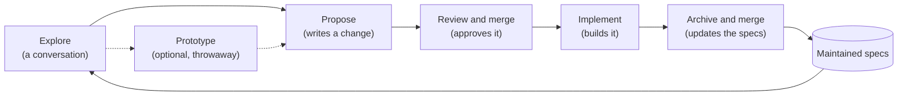

# Concepts

## The problem

Software drifts away from what anyone can explain about it. A coding agent
changes a lot of code quickly, and the reasons for each change are settled in
a conversation that ends when the session does. The next session starts from
the code alone, and the code cannot say which of its behaviors were agreed
and which just happened. After a few months nobody, person or agent, can say
with confidence what the software is supposed to do.

Grove keeps that answer written down, in your repository, next to the code.
Before something is built, you and your agent agree on it in writing. After
it is built, the written record is updated to match. The record is plain
Markdown, so people and agents read the same thing.

## Three things kept apart

- **A maintained spec** says how one part of your system should behave. It
  lives at `grove/specs/<capability>/spec.md` on your main branch, and it is
  agreed: someone merged it. Its first heading is its title, and the first
  sentence of its Purpose describes it
  ([maintained-specs spec](https://github.com/mascah/grove/blob/main/grove/specs/maintained-specs/spec.md)).
- **A change** is a proposal for future work. It lives in
  `grove/changes/<id>-<slug>/`. Once it is merged into your main branch it is
  approved, which means agreed, not built.
- **What the code does** is evidence. Where it differs from a spec, the spec
  says what was agreed and the code shows what happens; neither silently
  wins.

Mixing these up is how the drift starts: a draft read as if it were agreed,
an approved change read as if it were done, or today's code read as if it
were the plan. Grove's instructions tell your agent which is which, so a
conversation never treats a draft as agreed or an approved change as done.

## Approval is a merge

Grove has no approve button. A change is approved when its proposal is in
your main branch, which you choose in `grove.yaml` as `target`. Committing,
saving or ending a conversation approves nothing. Merge commits and squash
merges both count. If you commit a proposal straight onto your main branch,
that commit approves it.

A small change can take one merge instead of two. Propose it on a branch,
then build it there with `/grove-implement <change-id>`, with you in the
session. Merging that branch approves the change with its code. The same
merge lands the updated specs and the archived change. Grove sets no size; you
decide what is small. `--unattended` and `grove run` build only changes
your main branch already holds.

Your team already reviews and merges work into the main branch, and Git
already records who merged what and when. Making the merge the approval
means agreeing on a change uses the review you already do, and leaves no
second record of approval to fall out of step with the first.

`grove review` shows what merging the branch you are on would approve,
before you merge it.

## The loop

1. **Explore.** A conversation with your agent about what you want and what
   is true today. It writes nothing unless you ask.
2. **Prototype**, when it helps. Some questions could change what you
   propose, such as how something feels or whether it is feasible. For
   those, the agent builds a throwaway experiment on a `prototype/<slug>`
   branch and reports a verdict. That branch is never merged, and the
   prototype writes no Grove document. Its findings reach the main branch
   only in a proposal, which cites the branch and commit.
3. **Propose.** The agent writes a change from the conversation or from a
   description. First it asks you every decision it would otherwise
   assume, in one numbered round, with a recommended answer to each. What
   you leave open becomes an open question, never an assumption.
4. **Review and merge.** You read the change and merge it. Now it is
   approved. A small change can skip this merge: implement it on the same
   branch with you. Then the one merge after step 6 approves it with its
   code.
5. **Implement.** The agent builds the change on a branch with you and
   records progress. It asks you what the change leaves open. With your
   agreement, it revises the change on that branch, and your merge
   approves the revision with the code. With `--unattended`, it builds a
   change, or a cycle of changes in order, without you. Then it asks no
   one: a task an open question decides is marked blocked, and the change
   itself is never edited. A cycle is approved changes planned together (see
   [Planning cycles](planning.md)).
6. **Archive.** When every task is done, the agent folds the change's specs
   into the maintained specs and moves the change to
   `grove/changes/archive/`. You merge code, specs and archive together.

When one approved change must land before another, the later one names
it in `depends_on` (see [Coordinating changes](coordinating.md)).

A change you decide not to build is archived too, without touching the
specs; its `implementation.md` says `Status: dropped` and why.

What Grove requires at each step is the same in every project:

- Exploring writes nothing unless you ask.
- Prototyping writes no Grove document and never merges its branch.
- Only your merge approves a change.
- Implementing builds the change as your main branch holds it, or as you
  agreed to revise it while implementing. It records each task's status
  in `implementation.md`.
- Archiving refuses a change that is neither finished nor dropped. It
  also refuses a finished change whose requirements the maintained specs
  do not hold word for word.

## Why archive folds a change into the specs

A change says what is different: it adds, changes or removes requirements.
That is the right shape for agreeing on work, and the wrong shape for
reading what is agreed today, because you would have to replay every
change in order. So when a change is built, archiving writes its
requirements into the maintained specs, and the change itself moves to
`grove/changes/archive/`, where it stays as the record of why.

Because the code, the updated spec and the archived change are merged
together, a maintained spec changes in the same merge as the code it
describes. The next exploration starts from the maintained specs, so it
starts from what is agreed, not from a pile of proposals.

## A change

A `default` change folder holds:

| File | Written by | Says |
| --- | --- | --- |
| `.grove.yaml` | propose | Title, when it was created, its schema, the commit it was proposed from, the changes it waits on if any, and an optional one-line description. |
| `proposal.md` | propose, implement | Why, what changes, decisions with who made them, open questions. |
| `specs/<capability>/spec.md` | propose, implement | Requirements the change adds, changes or removes, for one capability each. |
| `tasks.md` | propose, implement | The work as numbered tasks, each with the files it touches, the interfaces it produces and how to check it is done, and, where you agreed, a `Delegated:` line naming choices and paths the implementer may take without asking. |
| `implementation.md` | implement, archive | Each task's status and evidence, each scenario of the change specs with the check that shows it or `unverified` and why, and which specs were updated. |

`tasks.md` is part of what was approved, so building it never edits it
except in a revision you agree to while implementing; progress goes in
`implementation.md`.

## Change schemas

Not every change is the same kind of work. A change schema decides which
documents a change holds and how each step goes for it. Grove has two:
`default`, the software change this page describes, and `bugfix`, for
behavior that is wrong, whose proposal shows the bug and whose first task
is a test that fails before the fix. When you describe a bug, the agent
suggests `bugfix`, and uses it once you confirm. A project can replace any
of their files and add schemas of its own; a change keeps the schema it was
proposed with (see [Reference](reference.md), "Change schemas", and the
[schemas spec](https://github.com/mascah/grove/blob/main/grove/specs/schemas/spec.md)).

A schema cannot change what Grove requires at each step, listed under "The
loop": every schema keeps the same approval, the same tasks in `tasks.md`
and the same progress in `implementation.md`.

## Two halves

The `grove` command runs in your terminal: it sets up, lists, checks, reviews
and reads. Skills run in your agent's chat: each one runs
`grove instructions <skill>` and follows what it prints, so Grove works with
the agent you already use, in the checkout and branch you already have.

Grove makes no commits. `grove run` is the one command that starts an
agent: one Claude Code session that builds a cycle unattended (see
[Running unattended](running.md)). Every other command leaves running
your agent to you.

## IDs

A change's ID is the date and five characters, such as `261015-k3m9q`. Its
folder adds a short name: `261015-k3m9q-let-users-rename-projects`. A
capability's ID is a short lowercase name, such as `projects`.

## Glossary

Each page uses these words in these meanings. A page may say again what a
word means where you need it; where it says it differently, this list
holds.

- **Approved:** merged into the target branch. Approved means agreed, not
  built.
- **Archive:** fold a change's specs into the maintained specs and move it to
  `changes/archive/`.
- **Archived as finished:** archived with every task done. A change that
  waits on another can be built once that one is archived as finished.
- **Attempt:** one session that `grove run` starts, with its own ID, branch
  and record in `.git/grove/`.
- **Base:** the commit of the target a change was proposed from, written in
  its `.grove.yaml`.
- **Blocked:** a task the agent could not build, because an open question
  decides it or the change cannot be built as it says. Its
  `implementation.md` says `Status: blocked` and why.
- **Build order:** the order a cycle's changes are built in: each after the
  changes it waits on, otherwise oldest first.
- **Capability:** one area of behavior, with one maintained spec.
- **Change:** a folder proposing future work.
- **Change schema:** what a kind of change consists of and how each skill
  goes for it; Grove's are `default` and `bugfix`.
- **Context:** instructions in `grove.yaml` given to every skill, so they
  reach agents working through Grove and no other session.
- **Cycle:** approved changes planned to be built together, in a file under
  `cycles/`. It is **done** when every change in it is archived, finished
  or dropped.
- **Draft:** a change, or any Grove document, that your working tree holds
  and the target does not. It is not agreed until it is merged.
- **Dropped:** archived without being built. Its `implementation.md` says
  `Status: dropped` and why, and it never counts as finished.
- **Harness:** the program you run your coding agent in. `grove init` writes
  skills for each harness `grove.yaml` lists.
- **Maintained spec:** agreed behavior of one capability.
- **Needs a person:** said of a change in a cycle whose `needs_human` names
  it, because you said an unattended session cannot build it.
- **Paused:** after an attempt, `grove run` starts nothing until the
  attempt's cycle is archived on the target.
- **Planned:** the commit of the target a cycle's plan read, written in its
  file as `planned`.
- **Skill:** a chat command Grove installs for your harness.
- **Stale:** out of date with the target. A change is stale when a
  requirement it modifies or removes was rewritten or removed since its
  base. A change in no cycle that is not done is also stale when a file
  one of its tasks names changed on the target since its base. A cycle is
  stale when one of its changes, or a file their tasks name, changed on the
  target since it was planned.
- **Target:** the branch whose contents count as agreed, usually `main`.
- **Unattended:** built with no one in the session, asking no one. A cycle
  marked `unattended: true` is handed to a `grove run` given no cycle.
- **Waits on:** a change waits on each change its `depends_on` names until
  that one is archived as finished; a cycle waits on each cycle its
  `depends_on` names until that one is done.
