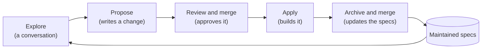

# Concepts

## The problem

Software drifts away from what anyone can explain about it. A coding agent
changes a lot of code quickly, and the reasons for each change are settled in
a conversation that ends when the session does. The next session starts from
the code alone, and the code cannot say which of its behaviors were agreed
and which just happened. After a few months nobody, person or agent, can say
with confidence what the software is supposed to do.

Grove keeps that answer written down, in your repository, next to the code.
Before something is built, you and your agent agree on it in writing. After
it is built, the written record is updated to match. The record is plain
Markdown, so people and agents read the same thing.

## Three things kept apart

- **A maintained spec** says how one part of your system should behave. It
  lives at `grove/specs/<capability>/spec.md` on your main branch, and it is
  agreed: someone merged it.
- **A change** is a proposal for future work. It lives in
  `grove/changes/<id>-<slug>/`. Once it is merged into your main branch it is
  approved, which means agreed, not built.
- **What the code does** is evidence. Where it differs from a spec, the spec
  says what was agreed and the code shows what happens; neither silently
  wins.

Mixing these up is how the drift starts: a draft read as if it were agreed,
an approved change read as if it were done, or today's code read as if it
were the plan. Grove's instructions tell your agent which is which, so a
conversation never treats a draft as agreed or an approved change as done.

## Approval is a merge

Grove has no approve button. A change is approved when its proposal is in
your main branch, which you choose in `grove.yaml` as `target`. Committing,
saving or ending a conversation approves nothing. Merge commits and squash
merges both count. If you commit a proposal straight onto your main branch,
that commit approves it.

Your team already reviews and merges work into the main branch, and Git
already records who merged what and when. Making the merge the approval
means agreeing on a change uses the review you already do, and leaves no
second record of approval to fall out of step with the first.

`grove review` shows what merging the branch you are on would approve,
before you merge it.

## The loop

1. **Explore.** A conversation with your agent about what you want and what
   is true today. It writes nothing unless you ask.
2. **Propose.** The agent writes a change from the conversation or from a
   description.
3. **Review and merge.** You read the change and merge it. Now it is
   approved.
4. **Apply.** The agent builds the change on a branch and records
   progress.
5. **Archive.** The agent folds the change's specs into the maintained specs
   and moves the change to `grove/changes/archive/`. You merge code, specs and
   archive together.

When one approved change must land before another, the later one names
it in `depends_on` (see [Coordinating changes](coordinating.md)).

A change you decide not to build is archived too, without touching the
specs; its `implementation.md` says `Status: dropped` and why.

What Grove requires at each step is the same in every project: exploring
writes nothing unless you ask, only your merge approves a change, applying
builds the change as your main branch holds it and records each task's
status in `implementation.md`, and archiving refuses a change that is
neither finished nor dropped.

## Why archive folds a change into the specs

A change says what is different: it adds, changes or removes requirements.
That is the right shape for agreeing on work, and the wrong shape for
reading what is agreed today, because you would have to replay every
change in order. So when a change is built, archiving writes its
requirements into the maintained specs, and the change itself moves to
`grove/changes/archive/`, where it stays as the record of why.

Because the code, the updated spec and the archived change are merged
together, a maintained spec changes in the same merge as the code it
describes. The next exploration starts from the maintained specs, so it
starts from what is agreed, not from a pile of proposals.

## A change

A `default` change folder holds:

| File | Written by | Says |
| --- | --- | --- |
| `.grove.yaml` | propose | Title, when it was created, its schema, the commit it was proposed from, the changes it waits on if any, and an optional one-line description. |
| `proposal.md` | propose | Why, what changes, decisions with who made them, open questions. |
| `specs/<capability>/spec.md` | propose | Requirements the change adds, changes or removes, for one capability each. |
| `tasks.md` | propose | The work as numbered tasks, each with how to check it is done. |
| `implementation.md` | apply, archive | Each task's status and evidence, and which specs were updated. |

`tasks.md` is part of what was approved, so applying it never edits it;
progress goes in `implementation.md`.

## Change schemas

Not every change is the same kind of work. A change schema decides which
documents a change holds and how each step goes for it. Grove's built-in
schema, `default`, is the software change this page describes. A project
can replace any of its files and add schemas of its own, such as one for
bug fixes; a change keeps the schema it was proposed with (see
[Reference](reference.md), "Change schemas").

A schema cannot change what Grove requires at each step, listed under "The
loop": every schema keeps the same approval, the same tasks in `tasks.md`
and the same progress in `implementation.md`.

## Two halves

The `grove` command runs in your terminal: it sets up, lists, checks, reviews
and reads. Skills run in your agent's chat: each one runs
`grove instructions <skill>` and follows what it prints. Grove starts no
agent and makes no commits, so it works with the agent you already use, in
the checkout and branch you already have.

## IDs

A change's ID is the date and five characters, such as `261015-k3m9q`. Its
folder adds a short name: `261015-k3m9q-let-users-rename-projects`. A
capability's ID is a short lowercase name, such as `projects`.

## Glossary

- **Approved:** merged into the target branch.
- **Archive:** fold a change's specs into the maintained specs and move it to
  `changes/archive/`.
- **Capability:** one area of behavior, with one maintained spec.
- **Change:** a folder proposing future work.
- **Change schema:** what a kind of change consists of and how each skill
  goes for it; Grove's is `default`.
- **Harness:** the program you run your coding agent in. `grove init` writes
  skills for each harness `grove.yaml` lists.
- **Maintained spec:** agreed behavior of one capability.
- **Skill:** a chat command Grove installs for your harness.
- **Target:** the branch whose contents count as agreed, usually `main`.
